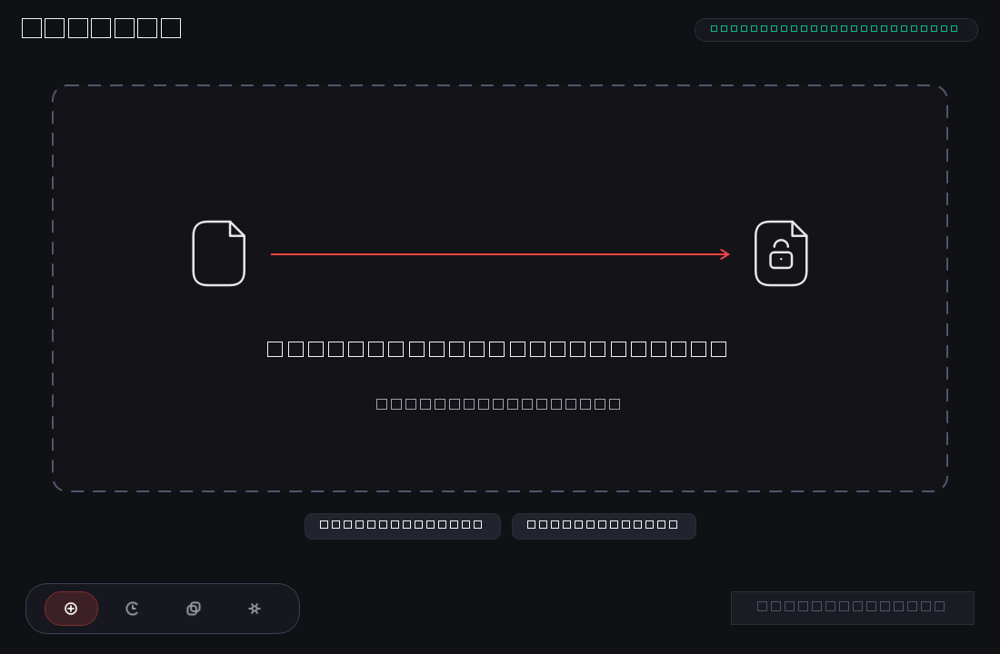
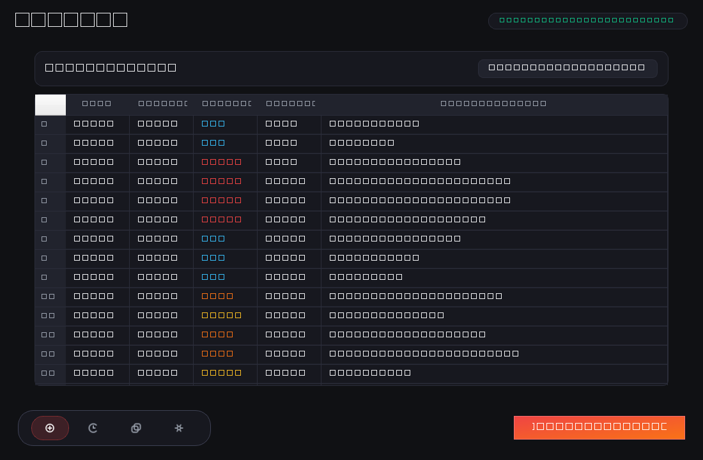
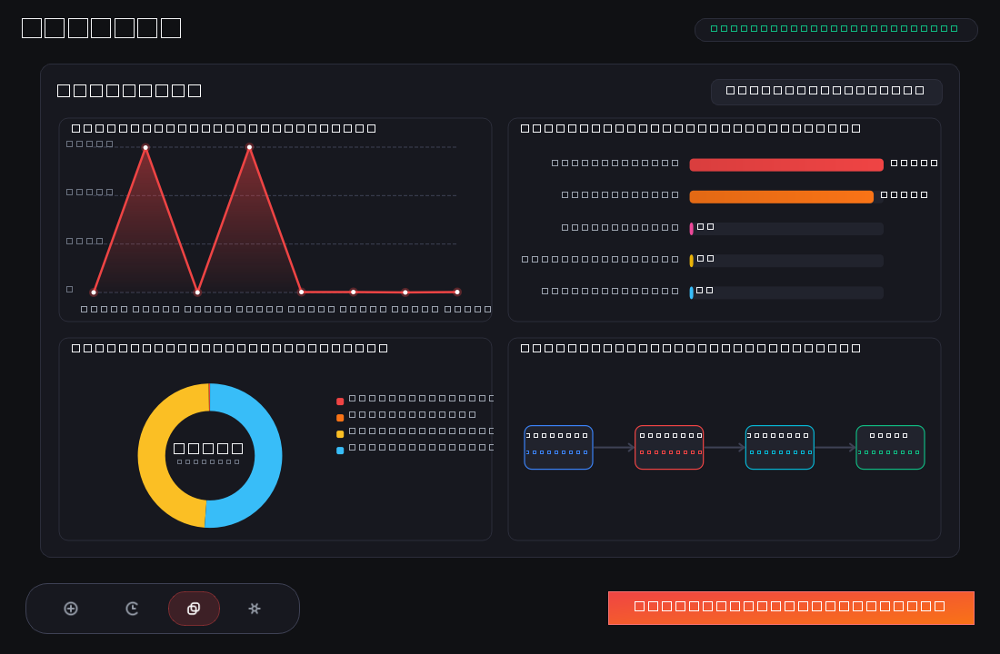
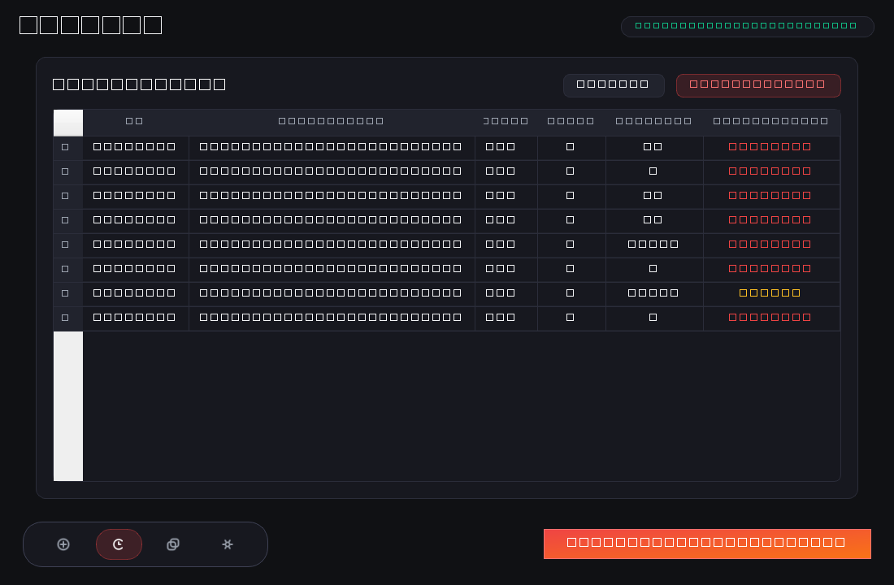

# RedactX 🛡️

### Local-First, Privacy-Preserving Data Loss Prevention & Sensitive Information Scanner

[](https://www.python.org/downloads/)
[](https://pypi.org/project/PySide6/)
[](LICENSE)
[](tests/)
[](#privacy-guarantee)

> **Core Axiom:** *The data being protected should not need to leave the machine in order to be inspected.*

---

## 📌 Overview

**RedactX** is a desktop Data Loss Prevention (DLP) utility designed to discover, validate, classify, and redact sensitive information locally within files and directories. 

Unlike traditional cloud scanners or SaaS security tools that require users to upload documents to external servers (creating an additional attack vector), **RedactX operates 100% offline with zero outbound network telemetry**.

```
                   USER MACHINE (AIR-GAPPED READY)
        +-------------------------------------------------+
        |                                                 |
        |   Original File  --->  Heuristic & Checksum     |
        |                        Scanner Engine           |
        |                              |                  |
        |                +-------------+-------------+    |
        |                |                           |    |
        |                v                           v    |
        |          Visual Report           Sanitized File |
        |        (Zero Plaintext Leak)    (Non-Destructive|
        |                                                 |
        +-------------------------------------------------+
                         NO CLOUD • NO API
```

---

## ✨ Key Capabilities

* **Multi-Stage Detection Pipeline:**
  * **Candidate Discovery:** Fast regex tokenization across `.txt`, `.csv`, and `.json`.
  * **Algorithmic Validation:** Luhn Modulo-10 checksum for financial cards; Verhoeff algorithm for Indian Aadhaar IDs; octet boundary enforcement for IPv4 addresses.
  * **Shannon Entropy Analysis:** Information-theoretic entropy calculation ($H(X) \ge 3.45$) to detect pseudo-random API tokens and access keys.
  * **Contextual Proximity Weighting:** $\pm 80$-character scanning window inspecting semantic assignment operators (`api_key=`, `secret:`, `token`).
* **Non-Destructive Redaction Engine:**
  * Generates separate `*_REDACTED` copies. The original file is **never** modified or overwritten.
  * Configurable strategies: **Partial Masking** (`r****l@gmail.com`), **Full Scrubbing** (`[REDACTED_CREDIT_CARD]`), and **Hash Tokenization** (SHA-256 pseudonymization).
* **Modern Obsidian Dark GUI (PySide6):**
  * Custom drag-and-drop hero dropzone.
  * Asynchronous, non-blocking background scanning with real-time file counters.
  * Reactive action triggers ("Create RedactX" glow state).
  * Analytical dashboard featuring dynamic Severity Donut, Category Violators Bar, Temporal Trend Area, and Data Lineage Flow graphs.
* **Zero-Leak Local Audit Log:**
  * Embedded SQLite database tracking scan summaries and file statistics without ever persisting raw plaintext secrets or sensitive tokens.

---

## 🔍 Supported Sensitive Data Entities

| Domain | Entity | Detection Method | Validation Technique | Severity Tier |
|:---|:---|:---|:---|:---|
| **Personal** | Email Address | RFC 5322 structural regex | TLD & domain sanity check | `LOW` |
| **Personal** | Indian Phone Number | Mobile format regex (`+91` / 10 digits) | Prefix validation (6–9) | `MEDIUM` |
| **Personal** | Aadhaar Number | 12-digit spaced pattern | **Verhoeff checksum algorithm** | `CRITICAL` |
| **Financial** | Credit/Debit Card | 13–19 digit patterns (Visa, MC, Amex) | **Luhn Modulo-10 algorithm** | `CRITICAL` |
| **Financial** | UPI ID | Virtual Payment Address | 40+ known bank PSP handle checks | `HIGH` |
| **Credentials** | API Key / Token | High-entropy string tokens | **Shannon Entropy ($H \ge 3.45$) + Context** | `CRITICAL` |
| **Credentials** | Password in Config | Assignment operator proximity | Character complexity & entropy | `CRITICAL` |
| **Network** | IPv4 Address | Dotted-quad notation | Octet bounds ($0 \le X \le 255$, non-loopback) | `LOW / MEDIUM` |

---

## 🖼️ Application UI Showcase

| Hero Upload & Dropzone | Live Scan Results & Review |
|:---:|:---:|
|  |  |

| Real-Time Analytical Dashboard | Local Audit History & Settings |
|:---:|:---:|
|  |  |

---

## 🚀 Quick Start

### Prerequisites
* **Python 3.12+**
* Windows 10/11 (or Linux/macOS with Qt support)

### Installation

1. **Clone the repository:**
   ```bash
   git clone https://github.com/shardulbhagdikar-dev/RedactX.git
   cd RedactX
   ```

2. **Create and activate a virtual environment:**
   ```powershell
   python -m venv .venv
   .\.venv\Scripts\Activate.ps1
   ```

3. **Install dependencies:**
   ```bash
   pip install -r requirements.txt
   ```

4. **Launch the desktop application:**
   ```bash
   python -m redactX.app
   ```

---

## 🧪 Running Automated Tests

RedactX includes a comprehensive automated test suite covering detectors, algorithmic validators, file parsers, redaction engines, audit history, and offscreen GUI views:

```bash
pytest
```
```text
============================= 103 passed in 1.10s =============================
```

---

## 📦 Building Standalone Windows Executable

RedactX can be compiled into a standalone, single-file Windows executable using PyInstaller:

```bash
pyinstaller redactx.spec
```
The resulting executable will be available at `dist/RedactX/RedactX.exe`.

---

## 📂 Project Architecture

```text
redactX/
├── app.py                     # Desktop application entrypoint (DPI scaling & Qt launch)
├── analysis/
│   ├── context.py             # Keyword proximity & context window evaluation
│   ├── entropy.py             # Shannon information entropy calculation
│   ├── risk.py                # Multi-factor severity & confidence scoring engine
│   └── validator.py           # Algorithmic validators (Luhn, Verhoeff, Octet)
├── detectors/
│   ├── base.py                # Abstract detector interface
│   ├── registry.py            # Central detector registry & candidate dispatcher
│   └── [email|phone|aadhaar|credit_card|upi|api_key|password|ip_address].py
├── gui/
│   ├── main_window.py         # Main window container & reactive triggers
│   ├── nav_bar.py             # Floating bottom pill navbar
│   ├── theme.py               # Obsidian dark styling (QSS) & design tokens
│   ├── charts.py              # Custom Qt painter charts (Donut, Bar, Trend, Lineage)
│   ├── worker.py              # Thread-safe QThread scan and redaction workers
│   └── views/
│       ├── scan_view.py       # Hero dropzone & live findings review table
│       ├── dashboard_view.py  # Threat metrics & data lineage visualization
│       ├── history_view.py    # Local SQLite scan history table
│       └── settings_view.py   # Granular detector toggles & masking policies
├── models/                    # Typed dataclasses (Finding, FileScanResult, Enums)
├── redaction/                 # Non-destructive file redactor & masking engines
├── scanner/                   # File parsers (TXT, CSV, JSON) & recursive directory walker
├── storage/                   # SQLite zero-leak audit persistence engine
└── utils/                     # Structured logging & masking string helpers
```

---

## 🗺️ Roadmap & Future Upgrades

See [FUTURE_UPGRADES.md](FUTURE_UPGRADES.md) for the detailed architectural roadmap, including:
* Native `.pdf` object-stream sanitization and Office OpenXML (`.docx`, `.xlsx`) support.
* Local embedded OCR (Tesseract / PaddleOCR) for image scanning.
* Zero-cloud Small Language Model (SLM) integration for contextual semantic leaks.
* Background directory daemon and Git pre-commit hook mode.

---

## 📄 License

This project is licensed under the MIT License - see the [LICENSE](LICENSE) file for details.
