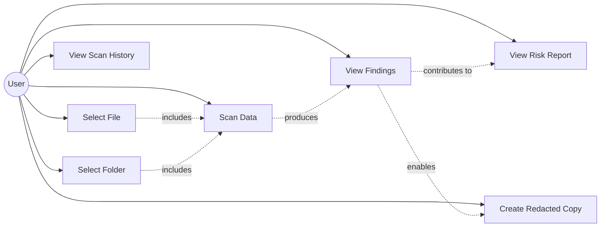
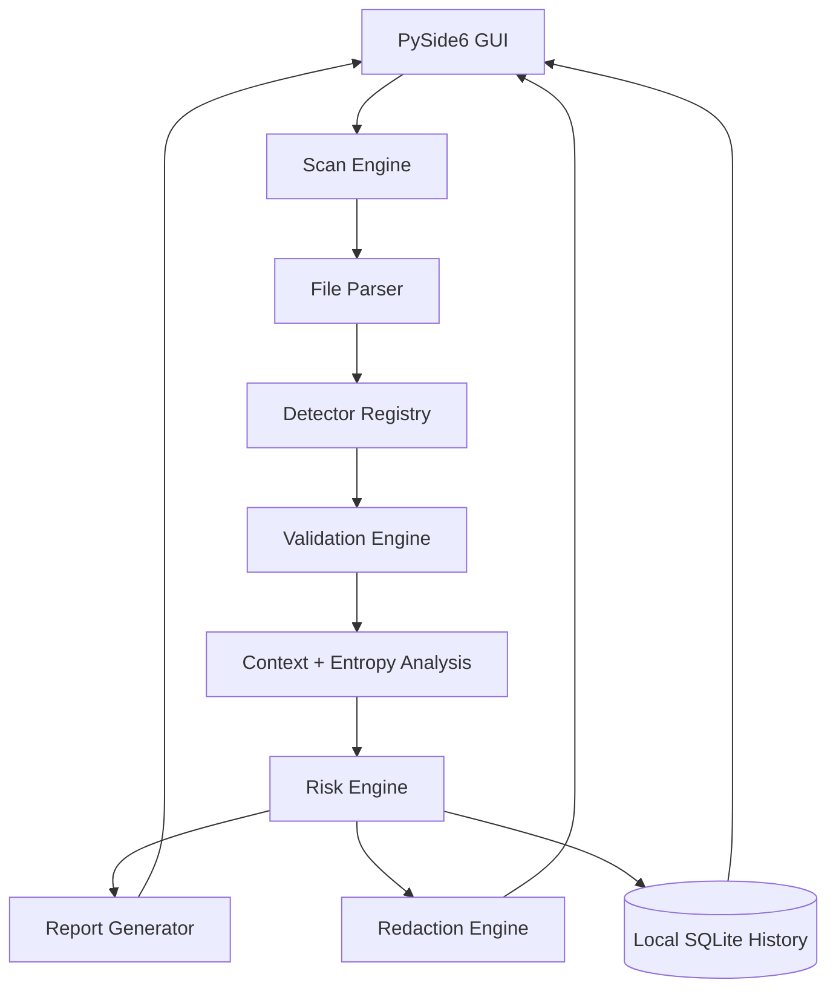
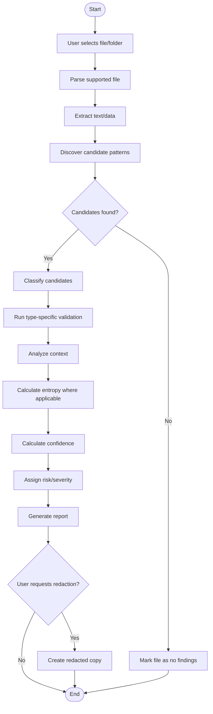
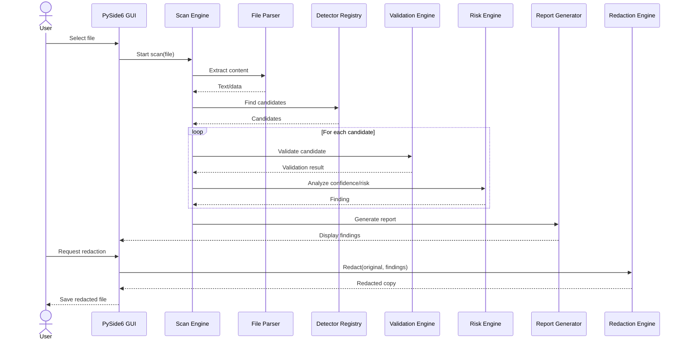
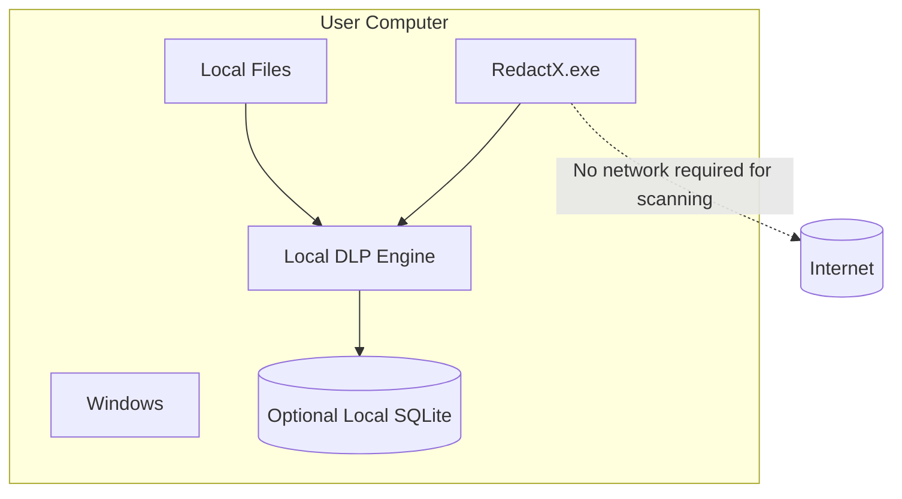
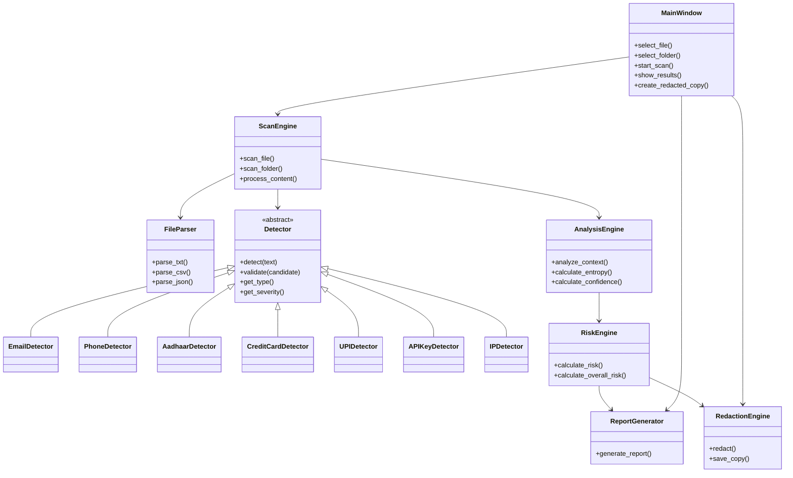

# RedactX
## Local Data Loss Prevention & Sensitive Information Scanner

**Project Type:** Cybersecurity Mini Project  
**Platform:** Windows Desktop Application  
**Language:** Python 3.12  
**GUI Framework:** PySide6  
**Primary Goal:** Detect and help remediate accidental exposure of sensitive information in local files without transmitting those files over a network.

---

## 1. Project Idea

**RedactX** is a privacy-preserving, local Data Loss Prevention (DLP) utility that scans files and folders for potentially sensitive information such as personally identifiable information (PII), financial information, credentials, and network identifiers.

The application will:

1. Scan supported local files.
2. Discover candidate sensitive-data patterns.
3. Classify detected information.
4. Validate candidates using type-specific checks.
5. Calculate confidence and risk.
6. Generate a security report.
7. Optionally create a redacted copy of the file.

The core scanner operates **entirely on the user's computer**. Original files are not uploaded to a server, cloud service, LLM API, or external analysis service.

### Core principle

> **The data being protected should not need to leave the machine in order to be inspected.**

---

# 2. Problem Statement

Sensitive information is frequently exposed unintentionally through documents, datasets, configuration files, source code, logs, and other locally stored files.

Examples include:

- Email addresses
- Phone numbers
- Government identifiers
- Credit/debit card numbers
- UPI IDs
- API keys
- Access tokens
- Password-like secrets
- IP addresses

Traditional web-based scanners create an additional privacy concern because users may need to upload the very files they are trying to protect.

RedactX addresses this problem through a **local-first DLP architecture** in which detection, validation, risk analysis, and redaction are performed locally.

---

# 3. Motivation

The project is motivated by three problems:

### 3.1 Accidental data exposure

Users may unknowingly share files containing sensitive information.

### 3.2 False positives

Simple pattern matching is insufficient. For example, every 16-digit number is not necessarily a credit card number.

### 3.3 Privacy of security scanning

A security scanner should not introduce another data-exposure channel by requiring sensitive files to be uploaded to a remote server.

RedactX therefore combines pattern matching with validation and contextual analysis while keeping the original data local.

---

# 4. Project Objectives

### Primary objectives

- Build a standalone Windows DLP application.
- Detect multiple categories of sensitive information.
- Reduce false positives through validation.
- Assign confidence and risk levels to findings.
- Generate an understandable security report.
- Create redacted copies of files.
- Ensure the core scanner does not require network connectivity.

### Secondary objectives

- Provide a modular detector architecture.
- Make individual detectors independently testable.
- Provide a foundation for adding new detectors later.
- Demonstrate privacy-by-design principles.

---

# 5. Finalized Scope

## 5.1 Supported input

### MVP

- `.txt`
- `.csv`
- `.json`

### Possible future extension

- `.xlsx`
- `.docx`
- `.pdf`

PDF and DOCX support are deliberately excluded from the initial MVP because document extraction adds substantial complexity without changing the core DLP detection problem.

---

# 6. Sensitive Data Detectors

The initial detector set should remain deliberately small.

## Personal Information

### Email Address
Detection through structural pattern matching.

### Indian Phone Number
Pattern matching with normalization and basic validation.

### Aadhaar-like Identifier
Candidate detection followed by format validation.

## Financial Information

### Credit/Debit Card Number
Candidate detection followed by **Luhn algorithm validation**.

### UPI ID
Pattern-based detection with structural validation.

## Credentials / Secrets

### API Key / Access Token
Detection using:

- suspicious keywords
- structural patterns
- entropy
- surrounding context

### Password-like Values
Detection around keywords such as:

`password`, `passwd`, `secret`, `token`, `credential`

## Network Information

### IPv4 Address
Pattern matching with octet validation.

---

# 7. Detection Architecture

RedactX should not be implemented as a simple collection of regular expressions.

The detection pipeline is inspired by the general engineering philosophy used by production secret-scanning tools such as TruffleHog: **discover candidates, classify them, validate them, and then produce a finding**.

RedactX intentionally has a much smaller scope and does **not** perform active credential verification or external API authentication.

```text
                    FILE / FOLDER
                         |
                         v
                +------------------+
                | File Extraction  |
                +--------+---------+
                         |
                         v
                +------------------+
                | Candidate        |
                | Discovery        |
                | Regex / Keywords |
                +--------+---------+
                         |
                         v
                +------------------+
                | Classification   |
                +--------+---------+
                         |
                         v
                +------------------+
                | Validation       |
                | Type-specific    |
                +--------+---------+
                         |
             +-----------+-----------+
             |                       |
             v                       v
        Context Analysis        Entropy Analysis
             |                       |
             +-----------+-----------+
                         |
                         v
                +------------------+
                | Confidence Score |
                +--------+---------+
                         |
                         v
                +------------------+
                | Risk Engine      |
                +--------+---------+
                         |
             +-----------+-----------+
             |                       |
             v                       v
          Report                 Redaction
```

---

# 8. Detection vs Validation

This distinction is central to the project.

For example:

```text
4532015112830366
```

should not automatically be classified as a credit card number merely because it contains 16 digits.

Instead:

```text
Candidate
   |
   v
16-digit pattern
   |
   v
Possible card number
   |
   v
Luhn validation
   |
   v
Validated finding
```

Other detectors can use specialized validation rules.

---

# 9. Context Analysis

Surrounding text can increase confidence.

For example:

```text
Aadhaar: 1234 5678 9012
```

provides stronger evidence than:

```text
123456789012
```

Similarly, the following context can strengthen secret detection:

```text
api_key=
access_token=
secret=
password=
authorization=
```

The system should never treat contextual keywords alone as proof of sensitive information.

---

# 10. Entropy Analysis

High-entropy strings can be useful indicators of randomly generated secrets.

For candidate secret strings, RedactX can calculate Shannon entropy:

\[
H(X) = -\sum p(x)\log_2 p(x)
\]

Entropy is used as a **supporting signal**, not as a standalone classifier.

Conceptually:

```text
API Key Candidate
       |
       +---- Pattern Match
       |
       +---- Keyword Match
       |
       +---- Entropy
       |
       +---- Context
       |
       v
  Confidence Score
```

---

# 11. Risk Classification

Each finding receives a severity level.

Initial policy:

| Data Type | Initial Severity |
|---|---|
| Email | LOW |
| IPv4 Address | LOW / MEDIUM |
| Phone Number | MEDIUM |
| UPI ID | HIGH |
| Aadhaar | CRITICAL |
| Credit/Debit Card | CRITICAL |
| API Key / Token | CRITICAL |
| Password-like Secret | CRITICAL |

The exact scoring formula should be defined and documented during implementation rather than arbitrarily claiming that the score represents a universal security standard.

Example:

```text
Finding count
+ data sensitivity
+ confidence
+ contextual indicators
        |
        v
Overall Risk
```

---

# 12. Redaction

Redaction is a remediation feature, not merely detection.

Example:

### Original

```text
Name: Rahul Sharma
Email: rahul@gmail.com
Phone: +91 9876543210
Aadhaar: 1234 5678 9012
```

### Redacted

```text
Name: Rahul Sharma
Email: r**********@gmail.com
Phone: +91 ********10
Aadhaar: XXXX XXXX XXXX
```

The original file must never be overwritten automatically.

The default behavior should be:

```text
employees.csv
        |
        v
employees_REDACTED.csv
```

---

# 13. Privacy and Security Architecture

This is one of the defining characteristics of RedactX.

## Local-only processing

```text
              USER COMPUTER

       +-------------------------+
       |                         |
       |     Original File       |
       |            |            |
       |            v            |
       |      DLP Scanner        |
       |            |            |
       |     +------+-------+    |
       |     |              |    |
       |     v              v    |
       |   Report        Redactor |
       |                    |     |
       |                    v     |
       |             Redacted Copy|
       |                         |
       +-------------------------+

               NO UPLOAD
               NO CLOUD
               NO LLM API
```

### Security requirements

- No original file uploads.
- No server-side document processing.
- No cloud storage for scanned files.
- No external DLP API.
- No LLM API.
- No automatic credential verification.
- Do not store sensitive values in application logs.
- Do not modify original files automatically.
- Scanning should work with network connectivity disabled.

### Important security claim

The project should state:

> **RedactX does not transmit scanned files as part of its core scanning functionality.**

It should not claim that an executable is inherently secure or that user data is universally impossible to compromise.

---

# 14. Technology Stack

## Programming Language

**Python 3.12**

Reasons:

- Rapid development
- Strong standard library
- Good filesystem support
- Easy testing
- Easy packaging into Windows executables
- Suitable for the project's scale

## GUI

**PySide6**

Reasons:

- Native-feeling desktop GUI
- File/folder dialogs
- Tables and progress bars
- Tabs and reusable widgets
- Better scalability than basic Tkinter for this project

## Packaging

**PyInstaller**

Target:

```text
RedactX.exe
```

## Testing

**pytest**

Used for:

- detector tests
- validation tests
- redaction tests
- risk scoring tests
- regression tests

---

# 15. Python Dependencies

Keep the dependency footprint deliberately small.

## Runtime

```text
PySide6
```

## Development / Packaging

```text
pytest
PyInstaller
```

## Optional

```text
openpyxl
```

Only if `.xlsx` support is added.

### Python standard library

Use standard library modules whenever practical:

```text
re
pathlib
csv
json
math
collections
hashlib
sqlite3
typing
dataclasses
```

No ML/LLM framework is required.

The MVP should not depend on:

```text
torch
tensorflow
transformers
scikit-learn
openai
langchain
```

---

# 16. Proposed Project Structure

```text
redactx/
│
├── main.py
├── requirements.txt
│
├── gui/
│   ├── main_window.py
│   ├── scan_view.py
│   ├── results_view.py
│   └── settings_view.py
│
├── scanner/
│   ├── scanner.py
│   ├── file_parser.py
│   └── walker.py
│
├── detectors/
│   ├── base.py
│   ├── email.py
│   ├── phone.py
│   ├── aadhaar.py
│   ├── credit_card.py
│   ├── upi.py
│   ├── api_key.py
│   └── ip_address.py
│
├── analysis/
│   ├── entropy.py
│   ├── context.py
│   ├── validator.py
│   └── risk.py
│
├── redaction/
│   └── redactor.py
│
├── reports/
│   └── reporter.py
│
├── config/
│   └── rules.json
│
└── tests/
    ├── test_email.py
    ├── test_phone.py
    ├── test_credit_card.py
    ├── test_aadhaar.py
    ├── test_secrets.py
    ├── test_risk.py
    └── test_redaction.py
```

The exact structure can change during implementation; the important architectural separation is between the GUI, scanner, detectors, analysis, redaction, and reporting layers.

---

# 17. Functional Requirements

## FR-01 — File Selection

The user shall be able to select a supported file for scanning.

## FR-02 — Folder Selection

The user shall be able to select a folder and recursively scan supported files.

## FR-03 — File Parsing

The application shall extract text/data from supported file types.

## FR-04 — Sensitive Data Detection

The application shall detect the defined sensitive-data categories.

## FR-05 — Validation

The application shall validate candidate findings using appropriate type-specific checks.

## FR-06 — Confidence

The application shall assign a confidence level to findings.

## FR-07 — Risk Classification

The application shall assign severity levels and an overall risk classification.

## FR-08 — Security Report

The application shall display:

- file name
- finding type
- location/context
- confidence
- severity
- explanation

## FR-09 — Redaction

The application shall generate a redacted copy of supported files.

## FR-10 — Original Preservation

The application shall not overwrite the original file by default.

## FR-11 — Offline Operation

The core scanning functionality shall operate without Internet access.

## FR-12 — Local Processing

The application shall not transmit scanned file contents to an external server.

---

# 18. Non-Functional Requirements

### Privacy

Sensitive files remain local.

### Performance

The scanner should process ordinary text/CSV/JSON files without noticeable delay.

### Usability

A user with minimal cybersecurity knowledge should be able to select a file, scan it, understand the results, and create a redacted copy.

### Maintainability

New detectors should be addable without modifying the entire scanning engine.

### Reliability

The application should not modify original files during scanning.

### Security

Sensitive values should not be written to application logs.

---

# 19. Explicitly Out of Scope

To prevent scope creep, the following are **not part of the MVP**:

- Enterprise DLP
- Network traffic inspection
- Email monitoring
- Cloud storage monitoring
- Endpoint-wide real-time monitoring
- SIEM functionality
- Machine learning
- LLM-based detection
- Active credential verification
- External API verification
- Git repository scanning
- Git history analysis
- PDF/DOCX parsing
- Multi-user accounts
- Centralized server
- Cloud dashboard
- Enterprise policy management

Possible extensions can be considered only after the MVP is complete.

---

# 20. UML Diagrams for Progress Check

The following diagrams are recommended for the progress presentation/report.

The diagrams use **Mermaid** syntax and can be rendered by compatible Markdown editors.

---

## 20.1 Use Case Diagram

Shows what a user can do with RedactX.



---

## 20.2 High-Level Component Diagram

Shows the major software components.



---

## 20.3 Activity Diagram — File Scanning

This is one of the most important diagrams for the progress check.



---

## 20.4 Sequence Diagram — Scan and Redact

Shows interaction between the GUI and internal components.



---

## 20.5 Deployment Diagram

This diagram demonstrates the privacy architecture.



The key message of this diagram is:

> **The original files and DLP processing remain on the user's machine.**

---

## 20.6 Class-Level Architecture

This is useful once implementation begins.



---

# 21. Suggested Progress Check Slides

For an early progress check, the following 6–7 slides are sufficient:

### Slide 1 — Title

**RedactX**

Local Data Loss Prevention & Sensitive Information Scanner

Team members + course + faculty.

### Slide 2 — Problem

Explain accidental sensitive-data exposure and the privacy problem with uploading sensitive files to online scanners.

### Slide 3 — Proposed Solution

Show:

```text
Local File
    ↓
Detection
    ↓
Validation
    ↓
Risk Analysis
    ↓
Report / Redaction
```

### Slide 4 — Scope

Show the supported file types and seven initial detector categories.

### Slide 5 — Architecture

Use the **component diagram**.

### Slide 6 — Workflow

Use the **activity diagram**.

### Slide 7 — Privacy Architecture

Use the **deployment diagram** and emphasize:

> **No original file leaves the user's machine.**

This should be enough to demonstrate that the project has moved beyond an idea into a defined engineering specification.

---

# 22. Future Scope

Only after the MVP is stable:

- PDF support
- DOCX support
- XLSX support
- Real-time folder monitoring
- Custom detector creation
- YARA-style rule support
- More sophisticated secret detection
- Entropy-based secret analysis improvements
- Local policy configuration
- Portable executable
- Digital signing
- Advanced reporting
- Optional comparison against established DLP/secret-scanning tools

Future scope should not be presented as part of the current implementation commitment.

---

# 23. Definition of Done — MVP

RedactX can be considered complete when:

- [x] Windows `.exe` can be launched by a user.
- [x] User can select a supported file.
- [x] User can select a folder.
- [x] TXT, CSV and JSON files can be parsed.
- [x] At least seven sensitive-data detectors work.
- [x] At least one specialized validator is implemented (Luhn).
- [x] Context analysis works for selected detectors.
- [x] Entropy analysis works for secret candidates.
- [x] Findings receive confidence and severity.
- [x] A report is displayed.
- [x] Redacted copies can be generated.
- [x] Original files remain untouched.
- [x] No network connection is required for scanning.
- [x] Unit tests cover the detector and validation logic.
- [x] Application does not log raw sensitive values.
- [x] Application can be packaged as `RedactX.exe`.

---

# 24. One-Sentence Project Definition

> **RedactX is a privacy-preserving Windows DLP utility that locally discovers, validates, classifies, and redacts sensitive information in files without transmitting the original data over a network.**
